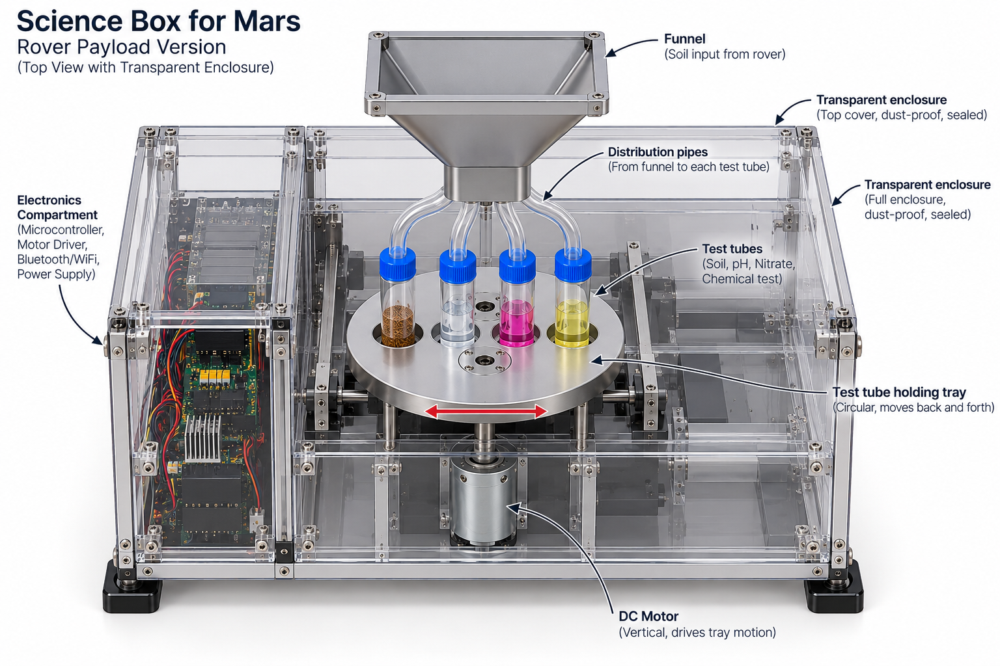
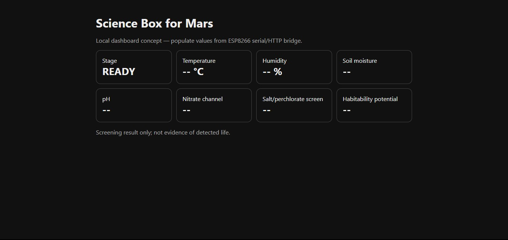

# Science Box for Mars

A university rover-payload concept for collecting soil in a removable cartridge, mixing samples, and recording soil and environmental measurements. The design uses an Arduino Mega 2560, a motor-driven tray, and separate dry-soil, pH, and reagent sections.

This is a terrestrial engineering prototype. Its measurements do not establish the presence of life or suitability for use on Mars.

*Concept illustration of the proposed payload layout.*

## How it works

A fixed funnel distributes soil into four cartridge sections. A break-beam sensor or START button begins the sequence. The tray moves to its home sensor, mixes the samples, reads the available inputs, and locks further starts until reset.

| Function | Current status |
| --- | --- |
| Sample trigger, homing, and mixing | Implemented in the control sketch. |
| Moisture and pH inputs | Raw ADC readings only; calibration is pending. |
| Temperature, humidity, and RGB sensing | Planned; sensor-reading code is pending. |
| LCD status display | Planned; not implemented in the sketch. |
| Bluetooth output | Start message and raw readings sent through `Serial1`. |
| Wi-Fi and dashboard | `Serial2` sends a result-ready marker; no network bridge or live dashboard connection is included. |
| Chemistry and habitability screening | Not configured; no concentration or screening score is calculated. |

## Repository materials

| Material | Location |
| --- | --- |
| Arduino Mega control sketch | [ScienceBoxMega.ino](firmware/ScienceBoxMega.ino) |
| Parts list | [BOM.csv](hardware/BOM.csv) |
| Circuit schematic | [Schematic image](hardware/Sch-SB.jpg) |
| PCB layout | [PCB image](hardware/PCB-SB.jpg) |
| Board preview | [3D board view](hardware/3D-Sb.jpg) |
| System overview | [Block diagram](hardware/science_box_block_diagram.svg) |
| Mechanical concept | [Design image](mechanical/Design.png) |
| Dashboard mock-up | [HTML page](dashboard/index.html) · [Preview image](dashboard/Dashboard.jpg) |
| Assembly and wiring notes | [Build notes](docs/BUILD_NOTES.md) |
| Current control sequence | [Test sequence](docs/TEST_SEQUENCE.md) |
| Measurement and interpretation notes | [Chemistry and habitability](docs/CHEMISTRY_AND_HABITABILITY.md) |

## Dashboard preview

Open `dashboard/index.html` locally in a browser to view the static mock-up. It contains placeholder values and does not receive sensor data.

## Build status

The schematic and sketch use different assignments for some signals, including moisture, pH, trigger, and motor control. Check the [firmware pin table](docs/BUILD_NOTES.md#firmware-pin-assignments) before wiring. The folder contains reference images; editable PCB and mechanical CAD files are not included.
